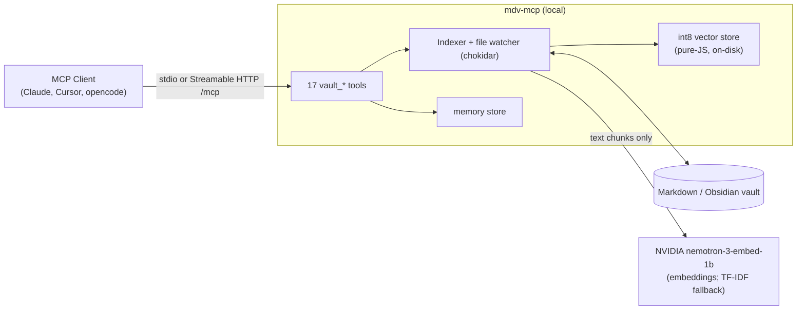

# mdv-mcp

> Local semantic search + memory over your Obsidian / markdown vault — as an MCP server.

[](./LICENSE)
[](https://github.com/chirag127/mdv-mcp/stargazers)
[](https://github.com/chirag127/mdv-mcp/commits)
[](https://www.npmjs.com/package/@chirag127/mdv-mcp)
[](https://nodejs.org/)

## What it is / why it exists

A **local** [MCP](https://modelcontextprotocol.io) server that makes your Obsidian / markdown vault searchable and writable by an AI assistant — without uploading a single file. It builds an on-disk, int8-quantized vector index over your notes (NVIDIA `nemotron-3-embed-1b` embeddings, with a keyless TF-IDF fallback), understands OKF v0.2 frontmatter and `[[wikilinks]]`, keeps the index live via a file watcher, and gives the model a persistent memory store. Folder-scoped via `--vault` or the MCP `roots` capability.

Your vault stays on your machine; only short text chunks go to NVIDIA for embedding, and vectors live locally in `<VAULT_ROOT>/.mdv-cache/`.

## Links

- **Live site:** <https://mdv-mcp.oriz.in>
- **GitHub Pages:** <https://chirag127.github.io/mdv-mcp/>
- **npm:** <https://www.npmjs.com/package/@chirag127/mdv-mcp>
- **Repo:** <https://github.com/chirag127/mdv-mcp>

⭐ If this is useful, please star the repo — it helps others find it.

## Architecture



## Features

- **Hybrid search** — NVIDIA `nemotron-3-embed-1b` (2048-dim) + TF-IDF via reciprocal-rank fusion
- **Local vector store** — pure-JS int8-quantized, on-disk, incremental (mtime-keyed)
- **Live watcher** — chokidar keeps the index current on file add/change/delete
- **OKF v0.2 frontmatter** — detect, validate, enrich (`vault_format apply=true`)
- **Wikilinks** — extract + resolve `[[wikilinks]]` to vault-relative paths
- **Persistent memory** — remember decisions/insights/todos across sessions
- **Dual transport** — stdio by default; first-class Streamable HTTP (MCP 2.0) via `--http`
- **Keyless-capable** — no NVIDIA key? Starts in TF-IDF fallback mode

## Tech stack

- **Node.js** (ESM, `>=18`)
- [`@modelcontextprotocol/sdk`](https://github.com/modelcontextprotocol/typescript-sdk), `zod`
- `gray-matter` (frontmatter), `chokidar` (file watcher)
- NVIDIA NIM embeddings API (optional)

## Repo structure

```
mdv-mcp/
├── src/
│   ├── index.mjs        # entry: CLI args, stdio transport, HTTP bootstrap
│   ├── http.mjs         # Streamable HTTP transport (MCP 2.0) at /mcp + /health
│   ├── server.mjs       # server assembly + tool registration
│   ├── tools/           # search.mjs, read.mjs, write.mjs, memory.mjs, reindex.mjs
│   └── lib/             # indexer, embeddings, vectorstore, vault, memory-store, formats
├── docs/                # GitHub Pages landing + configuration/tools/architecture/okf
├── .env.example         # env template (copy to .env)
└── package.json
```

## Tools

17 MCP tools. See [docs/tools.md](./docs/tools.md) for full params + examples.

| Tool | Description |
| --- | --- |
| `vault_search` | Hybrid semantic + keyword search |
| `vault_read` | Read file (frontmatter + body + format + wikilinks) |
| `vault_write` | Create/overwrite file (auto re-indexed) |
| `vault_delete` | Delete file (index entry removed) |
| `vault_list` | List `.md` files, optional subdir filter |
| `vault_tags` | Aggregate all tags by frequency |
| `vault_backlinks` | Files linking to a given file |
| `vault_frontmatter` | Parsed YAML frontmatter only |
| `vault_wikilinks` | Extract + resolve `[[wikilinks]]` |
| `vault_stats` | Index status (vault root, dims, embedding mode) |
| `vault_reindex` | Force incremental re-embed sync |
| `vault_format` | OKF validation + enrichment (`apply=true` writes back) |
| `vault_remember` | Save persistent memory |
| `vault_recall` | Retrieve past memories |
| `vault_memory_stats` | Memory store statistics |
| `vault_memory_archive` | Archive a memory by ID |
| `vault_install_opencode` | Install the opencode integration |

## Quick start

### Install / run

```bash
# Run directly (no install)
npx -y @chirag127/mdv-mcp --vault /path/to/notes

# Or install globally
npm install -g @chirag127/mdv-mcp
mdv-mcp --vault /path/to/notes
```

### MCP client config (stdio)

```json
{
  "mcpServers": {
    "mdv-mcp": {
      "command": "npx",
      "args": ["-y", "@chirag127/mdv-mcp", "--vault", "C:/path/to/notes"],
      "env": { "NVIDIA_API_KEY": "nvapi-..." }
    }
  }
}
```

No NVIDIA key? Omit `env` — the server starts in TF-IDF fallback mode.

### Streamable HTTP (MCP 2.0)

```bash
# any of these enables HTTP (default host localhost, port 3777)
npm run start:http -- --vault /path/to/notes
node src/index.mjs --http --vault /path/to/notes
HTTP_PORT=3777 node src/index.mjs --vault /path/to/notes
```

Register in an HTTP-capable client:

```json
{ "type": "http", "url": "http://localhost:3777/mcp" }
```

> **Local by design.** HTTP binds `localhost` and serves the *local* vault — not a public service unless you deliberately host it behind a secured reverse proxy.

### Vault targeting

| Priority | Source |
| --- | --- |
| 1 | `--vault <path>` CLI arg |
| 2 | MCP `roots` capability (first root from client) |
| 3 | `VAULT_ROOT` env var |
| 4 | `cwd` |

### Self-test

```bash
node src/selftest.mjs --vault /path/to/notes
```

## Configuration

Copy `.env.example` → `.env`. Names + purpose only:

| Variable | Purpose |
| --- | --- |
| `NVIDIA_API_KEY` | NVIDIA NIM key for embeddings (omit → TF-IDF fallback) |
| `VAULT_ROOT` | Absolute path to the vault root |
| `NVIDIA_EMBED_MODEL` | Embedding model id (default `nvidia/nemotron-3-embed-1b`) |
| `NVIDIA_BASE_URL` | NVIDIA NIM base URL |
| `MDV_CACHE_DIR` | Vector-index cache dir (default `<VAULT_ROOT>/.mdv-cache`) |
| `HTTP_PORT` / `HTTP_TRANSPORT` / `HTTP_HOST` | Streamable HTTP transport controls |

No secrets are committed; `.env` is gitignored.

## Docs

- [Configuration](./docs/configuration.md) · [Tools](./docs/tools.md) · [Architecture](./docs/architecture.md) · [OKF frontmatter](./docs/okf.md) · [Development](./docs/development.md)

## Part of the oriz family

One of ~80 sites and tools in the [oriz](https://blog.oriz.in) family. Complements the hosted [knowledge-mcp](https://github.com/chirag127/knowledge-mcp) (public knowledge base) with a fully-local, private vault index.

## Contributing

Issues and PRs welcome. Conventional commits are the changelog.

## License

MIT — see [LICENSE](LICENSE).

## Author

Chirag Singhal · <chirag@oriz.in> · [@chirag127](https://github.com/chirag127)

## Status

Stable (`v3.0.0`). Roadmap: richer OKF enrichment, more embedding backends.
